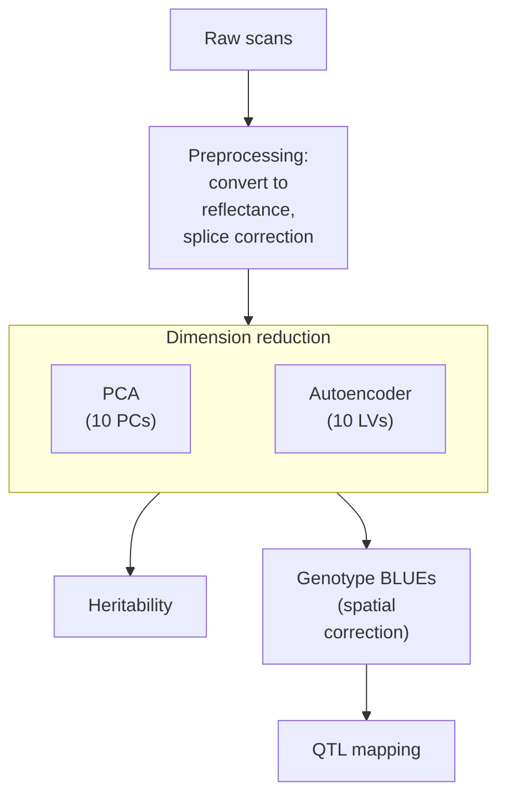

# HypeSpec
For analyzing hyperspectral data taken on maize leaves.

Unsupervised leaf-reflectance phenotypes for the ZEAL (BZea) teosinte
introgression population, following Tross et al. 2024 (Plant Phenome J.
7:e20106, doi:10.1002/ppj2.20106). Data: FieldSpec4 scans of leaf 2 above the
ear, CLY25-B5 block 2 (921 plots, 5 scans per plot, 2025-07-18 to 07-26).

## Pipeline

## Layout

| Folder | Contents |
|---|---|
| `scripts/` | Numbered pipeline scripts; `tross2024/` holds the vendored Tross code (see its README) |
| `data/` | Inputs (gitignored) |
| `output/` | Results (gitignored) |

R scripts run from the repo root with `Rscript scripts/<name>.R`. Python
scripts use the local environment: `.venv/Scripts/python scripts/<name>.py`
(TensorFlow, tf_keras, pandas, scikit-learn, h5py, openpyxl).

## Scripts

Run in order. Steps marked † also run on the non-senesced plots with
`TAG=_green EXCLUDE=output/outlier_group_plots.csv` (R) or
`--exclude output/outlier_group_plots.csv --tag _green` (04).

| Script | Does |
|---|---|
| `01_plot_spectra.R` | `.spc` scans → reflectance, splice correction, 5-scan plot means, plot metadata |
| `02_pca.R` † | PCA (10 PCs), component table, PC1 vs PC2 figures |
| `03_senesced_group.R` | Characterises the high-PC1 (senesced) plots; writes the exclusion list |
| `04_train_autoencoder.py` † | Retrains the Tross autoencoder (10 LVs) |
| `05_tross_pretrained.py` | Applies Tross's trained encoder, after checking it reproduces their LVs |
| `06_component_genetics.R` † | Per component: Spearman ρ, generalized H², genotype BLUEs |
| `07_compare_sets.R` | All plots vs non-senesced plots, by method |
| `08_component_spectra.R` | Score–reflectance correlation profiles of selected components |
| `09_spectrum_regions_figure.R` | Mean spectrum with detector ranges and absorption features |
| `10_vegetation_indices.py` | 28 vegetation indices (Table 1 of the stay-green paper) → spreadsheet |
| `11_vegetation_index_genetics.R` | NDVI/NDRE and Table-1 indices: H² and genotype BLUEs |
| `12_int_panel.R` | Pre-specified 8-trait panel, rank-INT of BLUEs |
| `lib.R` | Shared helpers: TAG/EXCLUDE, SpATS fits, BLUE writer, feature lookup |
