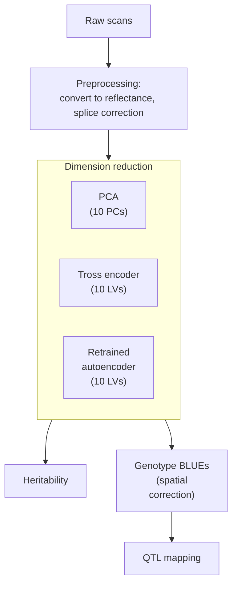

# HypeSpec
For analyzing hyperspectral data taken on maize leaves.

Unsupervised leaf-reflectance phenotypes for the ZEAL (BZea) teosinte
introgression population, following Tross et al. 2024 (Plant Phenome J.
7:e20106, doi:10.1002/ppj2.20106). Data: FieldSpec4 scans of leaf 2 above the
ear, CLY25-B5 block 2 (921 plots, 5 scans per plot, 2025-07-18 to 07-26).

## Pipeline

## Layout

| Folder | Contents |
|---|---|
| `scripts/` | Numbered pipeline scripts; `tross2024/` holds the vendored Tross code (see its README) |
| `data/` | Inputs (gitignored) |
| `output/` | Results (gitignored) |

R scripts run from the repo root with `Rscript scripts/<name>.R`. Python
scripts use the local environment: `.venv/Scripts/python scripts/<name>.py`
(TensorFlow, tf_keras, pandas, scikit-learn, h5py).
